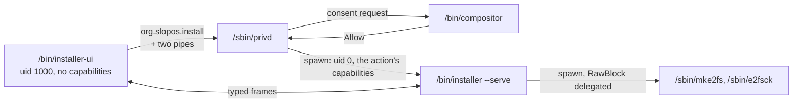

# A Graphical Installer

## Goal

Let a person install SlopOS from the live medium through a window, with the
same engine, the same guarantees and the same tests as the CLI. When this plan
is done:

- **Welcome window.** A live boot opens a *Welcome* window with two choices,
  *Try SlopOS* and *Install SlopOS*. The dock carries an *Install SlopOS* entry
  while the system runs from a medium.
- **Wizard.** `/bin/installer-ui` walks a linear wizard: Disk → How → Review →
  Install → Done or Error. Back keeps every answer. It runs as the session user
  and holds no capability.
- **Engine.** The UI never touches a disk. It asks privd for
  `org.slopos.install`, the compositor asks the person for consent, and privd
  runs `/bin/installer --serve` with the install capabilities on the UI's pipes.
  The two then speak a typed frame protocol.
- **Proposals.** The engine computes every proposal: the before and after
  partition bars, the action list, and the issues that block a choice. It
  checks again at Install that the disk is still the one reviewed.
- **Root size.** The root's size is a choice in erase and free-space installs.
  The CLI gains `--root-size`.
- **CLI.** The CLI stays as it is: the same engine with a human renderer, the
  same questions, flags and output lines.

## Depends on

The access model, which has landed (`AGENTS.md`, *Authority discipline*). This
plan uses:
- the session uid;
- privd, its action policy and `slopos_userland::privd::elevate`;
- compositor consent;
- `RawBlock` delegation to e2fsprogs;
- `DacOverride` for the new root's ownership map.

## Where it stands

**The installer.**
- `/bin/installer` is `userland/src/apps/installer/`, an engine, a CLI
  renderer and a protocol server over the disk, root and boot code. It shares
  `userland/src/boot_disk.rs` with `bootctl` and the tests. Only
  `installer_main` is public.
  - `engine.rs`: `System::probe` reads the medium and every whole disk,
    `System::open` re-reads the chosen disk's table, `System::propose` lays
    `Choices` out as a `Settled` install or answers an `Issue`, and
    `System::install` runs the steps, reporting `Event`s, and answers a
    `Summary` or a `Failure`. `System::view` is what it read as
    `installer-core` states it, each opened disk with what every choice on
    it proposes.
  - `cli.rs`: the questions, every one also a flag, the summary, the typed
    confirmation (the disk's name to erase, `yes` otherwise), and the events
    as `installer:` lines.
  - `serve.rs`: `installer --serve`, the same engine over the protocol on
    stdin and stdout, only as privd's `org.slopos.install`.
  - `medium.rs`, `disk.rs`, `root.rs` and `boot.rs`: what the engine reads
    and writes.
- `installer-core` is what the engine and a driver agree on, `no_std` and
  host-tested: the views (`System`, `Proposal`), `Choices`, `Issue`,
  `Event`, `Summary`, `Failure`, the step titles, the protocol and its codec,
  and the `Wizard` the window's pages follow.
- The CLI asks for the disk, then the mode (erase, free or reuse, forced to
  erase on a disk without a readable GPT), the root partition, the free
  region, whether to keep the root, the `/src` remote, whether SlopOS goes
  first in `BootOrder` and the first person. `--root-size` is a flag only.
- `install` runs the nine steps `installer_core::STEPS` names:
  1. writing the partition table
  2. re-reading it
  3. formatting the new partitions
  4. filling the root
  5. writing both kernel slots and the base
  6. writing the loader and its configuration
  7. making slot a the default
  8. checking the root
  9. registering the firmware entry

**Planning is pure.** `boot-core::install::{plan, regions, Plan, PlanError,
RootSize}` is `no_std` and host-tested. A new root takes its target clamped
between the medium's minimum and the rest of the region; the crash partition
follows it and the rest stays free.

**Failure is re-runnable, not rolled back.** An interrupted erase leaves a
disk that only erase installs onto (`disk::write_table`). A half-made ESP or
boot partition is detected and reformatted (`System::formats`). tree-core
writes an `UNFINISHED` manifest before it copies, `/src` is staged and
renamed, and the firmware entry comes last.

**Tests.**
- `installer_test` types the blank disk's answers into `/bin/shell -c
  "installer …"`, gives the foreign disk flags and a root size and the
  reinstall flags, and installs the reuse disk through privd and `--serve`
  as `root` with a scripted protocol client. It holds every installed root to
  its `/var/log/installer.log`, the foreign disk's install, confirmed after
  its table was renamed, to writing nothing, and a driver that leaves before
  `Install` to the same.
- `just test-installer` greps the installer's own lines, e2fsck's among them,
  which the protocol client prints as the CLI does.
- The host then holds every table, volume and foreign byte to what it must
  be, and the foreign disk's root to the size asked, the crash partition
  after it and free space after both.

**The live desktop.**
- init starts the compositor and then the terminal; nothing knows it is live
  (`userland/src/apps/init/`).
- The dock pins five programs (`userland/src/apps/compositor/dock.rs:135-177`).

**appkit has what the window needs.**
- An app implements `App { view, update, tick, on_key, on_close_request }`
  and calls `run_app` (`appkit/src/node.rs`). `on_start` hands it an
  `AppSender`, through which a thread sends it messages that reach `update`.
- It has these widgets: Label, Button (Primary, Secondary, Destructive),
  Checkbox, RadioGroup, Slider, LineEdit, ProgressBar (indeterminate without a
  value), PartitionBar, ListView, Table, ScrollView, TabBar, and a Dialog
  whose actions take no focus until Tab or an arrow. `widget_gallery` shows
  them.
- ProgressBar's default fill is a load meter that turns yellow and red; the
  window names a colour.
- The theme is dark only, the scale is 1, and a client cannot ask for
  fullscreen (`slop-protocol/src/types.rs`).

## What the prior art settles

| Source | What it shows | Taken here |
|---|---|---|
| Fedora Anaconda WebUI ([redesign](https://fedoramagazine.org/anaconda-installer-redesign/), [ReviewConfiguration.jsx](https://github.com/rhinstaller/anaconda-webui/blob/main/src/components/review/ReviewConfiguration.jsx)) | Dropped hub-and-spoke because it "can feel like jumping around". Pick what you want to achieve, not how. A review page with a scenario-labelled install button that stays disabled until a checkbox whose wording scales with the damage is ticked. "Reinstall" is shown only when an install is detected. | linear wizard, task tiles, the review checkbox and button, reinstall only when found |
| Ubuntu ([installer steps](https://github.com/canonical/ubuntu-desktop-provision/blob/main/apps/ubuntu_bootstrap/lib/app/installation_step.dart), [design notes](https://canonical.com/blog/how-we-designed-the-new-ubuntu-desktop-installer), [Subiquity DESIGN.md](https://github.com/canonical/subiquity/blob/main/DESIGN.md)) | A Try-or-Install landing. A separate confirm screen whose partition rows read Erased / Unchanged / Resized. A size slider paired with a numeric box. The window cannot be closed while installing. A privileged engine computes storage and the UI only renders it, with nothing written before confirm. | welcome window, action list with tags, slider plus box, close refused, engine-owned proposals |
| Calamares ([ChoicePage.cpp](https://codeberg.org/Calamares/calamares/src/branch/calamares/src/modules/partition/gui/ChoicePage.cpp)) | "Current:" and "After:" bars. | the Now and After bars |
| elementary ([Drive Selection](https://github.com/elementary/installer/wiki/Drive-Selection), [Progress](https://github.com/elementary/installer/wiki/Progress)) | The boot drive and too-small drives are shown but disabled and sorted last; Calamares hides them silently and earns a "my disk isn't visible" FAQ. Progress has no back or forward. | unofferable disks shown disabled with their reason, no cancel after confirm |
| Agama ([agama#1770](https://github.com/agama-project/agama/issues/1770), [HTTP API](https://github.com/agama-project/agama/blob/master/doc/http_api.md)) | Hub users lose their place. Every config change recomputes the proposal at once. | no hub; every choice re-proposes |
| Redox ([installer](https://gitlab.redox-os.org/redox-os/installer), [the book](https://doc.redox-os.org/book/installing.html)) | Its GUI shows "Installation progress is in terminal" because the library prints instead of emitting events. TUI and GUI copy the pipeline, and the copy ends a failed clone on the success page. The GUI runs the library in-process, the whole window elevated through `pkexec` or its sudo scheme. Its one size option is the image file's. It has no review page and no mounted-disk guard, and its CI never boots an installed image. | an engine that emits events and never prints; one pipeline; an unprivileged window beside a privileged engine; review page; the QEMU install tests kept |
| Anaconda, curtin and Subiquity, Calamares ([anaconda util.py](https://github.com/rhinstaller/anaconda/blob/main/pyanaconda/core/util.py), [curtin install.py](https://github.com/canonical/curtin/blob/main/curtin/commands/install.py), [subiquity storage.py](https://github.com/canonical/subiquity/blob/main/subiquity/server/controllers/storage.py), [Calamares Runner.cpp](https://github.com/calamares/calamares/blob/calamares/src/libcalamares/utils/Runner.cpp)) | Each captures mkfs's output into its log. Anaconda and Subiquity copy their logs to the target only on success; curtin copies its log in a `finally`, so a failed install keeps it. None reads the disk again between confirmation and the first write, and Subiquity stops probing once storage is configured. Byte totals reach a UI only as message text (Anaconda's rsync percentage). | e2fsprogs's output as log lines, the log kept on the root after a failure too, the disk read again before the first write, and typed byte totals |
| Subiquity and kickstart ([subiquity types/storage.py](https://github.com/canonical/subiquity/blob/main/subiquity/common/types/storage.py), [subiquity server.py](https://github.com/canonical/subiquity/blob/main/subiquity/server/server.py), [pykickstart `part`](https://pykickstart.readthedocs.io/en/latest/kickstart-docs.html)) | Subiquity's server answers each gap with its size range and a reason when too small, refuses a size outside it, and keeps serving after a failed install. Kickstart's `--size` with `--grow --maxsize` clamps between bounds. None of Subiquity, Anaconda, Calamares' KPMcore helper or Redox checks a version between the UI and its privileged backend; each ships both in one package. | each opened disk's choices with the reason they do not fit, the root size clamped, an engine that serves on after `Failed`, and a `Hello` naming the protocol, since a live base switch can put a newer engine under an older window |
| WAI-ARIA, GTK4, Qt ([APG radio](https://www.w3.org/WAI/ARIA/apg/patterns/radio/), [APG slider](https://www.w3.org/WAI/ARIA/apg/patterns/slider/), [gtkscale.c](https://github.com/GNOME/gtk/blob/main/gtk/gtkscale.c), [gtkprogressbar.c](https://github.com/GNOME/gtk/blob/main/gtk/gtkprogressbar.c), [qabstractslider.cpp](https://github.com/qt/qtbase/blob/dev/src/widgets/widgets/qabstractslider.cpp), [qeventdispatcher_unix.cpp](https://github.com/qt/qtbase/blob/dev/src/corelib/kernel/qeventdispatcher_unix.cpp)) | A radio group is one tab stop whose selection follows the arrows; the APG wraps at the ends, GTK and Qt do not. A slider's arrows work on either axis, Home and End go to the ends, and a page is 10 steps in GTK and Qt, only "larger than a step" in the APG. GTK's pulse moves only while the app pulses, so a stuck worker shows a frozen bar. Qt's wake pipe is written only on a flag's 0→1 and drained before the queue is read. | APG's wrapping radio group; a page as a tenth of the range, since a byte slider's step is a MiB; the app's tick drives the indeterminate bar; the coalesced wake |
| GParted, KDE Partition Manager, Calamares ([DrawingAreaVisualDisk.cc](https://github.com/GNOME/gparted/blob/master/src/DrawingAreaVisualDisk.cc), [partwidgetbase.cpp](https://lxr.kde.org/source/system/kpmcore/src/gui/partwidgetbase.cpp), [PartitionBarsView.cpp](https://github.com/calamares/calamares/blob/calamares/src/modules/partition/gui/PartitionBarsView.cpp)) | Every segment gets a pixel minimum (10 px, 30 px, 1%), the rest shared in proportion. GParted draws a label inside a segment only when it fits; Calamares and KPM put labels in a legend. | a floor and the rest in proportion, labels inside when they fit, the action list for the rest |
| Asterinas ([distro README](https://github.com/asterinas/asterinas/blob/ec5bb9ed798851b4c1854e791341321902ac8bc9/book/src/distro/README.md)) | No installer UI: a NixOS ISO, a root shell and a script. Its CI does install end to end in QEMU. | nothing to borrow for the UI; confirms end-to-end install grading |

## Design

### Processes



- **The request.** The UI makes two pipes and asks privd for
  `org.slopos.install` with argv `--serve`, handing over the engine's ends as
  stdin and stdout. Consent is asked once, when the person presses *Install
  SlopOS*, because even reading the disks' partition tables takes `RawBlock`.
- **The action.** From the access plan's policy:

  ```
  action org.slopos.install
    program  /bin/installer
    args     *
    caps     RawBlock Mount Power BootEntry Seal DacOverride
    uid      0
    allow    admin confirm
    exclusive
  ```

- **If the UI dies.** The engine notices end-of-file and exits before an
  `Install` frame without writing anything. After one, it runs to the end,
  because the steps are not interrupted. It writes its log into the new root.
- **The CLI.** `installer` typed in a terminal elevates itself through the
  same action with its own argv and the terminal as stdio, and asks its
  questions there.

### The engine and its protocol

Phases 1 and 2 built them: `installer::engine`, `installer --serve` and
`installer-core` (*Where it stands*, *Decided*). The protocol is
`installer_core::protocol`, whose module doc is its statement.

### The window

`/bin/installer-ui` is an appkit app with app id `org.slopos.installer` and a
900 × 640 window, which fits 1280 × 720; there is no fullscreen request to
ask for a bigger one. Its pages, answers, enablement and wording are
`installer_core::wizard::Wizard`'s, which also says when to start the
engine, restart or close; the app renders them and carries frames. The
request to privd, which waits on the person's consent, and a reader of the
engine's frames run on threads of their own and send what they get through
the app's `AppSender`, so the window keeps drawing meanwhile. The
window has a header with the step strip (*Disk · How · Review · Install*),
the page, and a footer with Back and the page's primary button. Everything
is reachable with Tab, Enter activates, and Escape is Back on every page but
Install.

1. **Welcome.** *Try SlopOS* closes the window; *Install SlopOS* asks privd,
   then probes.
   - A medium with no payload says so once probed, with the CLI's wording
     ("the medium carries no toolchain").
   - A refused or expired consent leaves the person here, with the reason.
2. **Disk.** Offered disks come first. Each row shows the node, the capacity,
   and what the disk holds: "blank", "GPT: EFI system, Windows (basic data),
   120 GiB free", or "an MBR partition table with 2 partitions".
   - Disks the engine will not offer (the medium, write-protected) are shown
     disabled and sorted last, with the reason.
   - A *Rescan* button sits below the list.
3. **How.** Task tiles in a radio group:
   - *Erase disk and install*.
   - *Install beside what is there*: free space. It is disabled with the
     planner's reason when no region fits. A region picker appears when two or
     more fit, defaulting to the largest.
   - *Use a partition as the root*: a partition list.
   - *Reinstall SlopOS*: shown only when a SlopOS root is found. It reuses that
     root, keeping it.

   A disk without a readable GPT offers erase alone and says why. Under the
   tiles sit a *Now* bar, an *After* bar and, for erase and free, the root size
   slider with a numeric box. *Options* holds the `/src` remote (when the
   payload has `/src`) and "Put SlopOS first in the firmware boot order", which
   is off by default. Every change sends `Propose`, and the bars and the
   button follow the reply.
4. **Review.**
   - A summary: disk, mode, root size, toolchain, the `/src` remote, boot
     order.
   - The action list with its tags.
   - The other systems the boot menu will offer, and any it leaves out.
   - A checkbox whose text follows the mode:
     - erase: "I understand that everything on nvme0n1 will be erased";
     - free: "I understand that new partitions will be created in free space
       on nvme0n1, and nothing else on it changes";
     - reuse: "I understand that nvme0n1p3 will be formatted".
   - The Destructive primary button stays disabled until the box is ticked. It
     is labelled by scenario: *Erase nvme0n1 and install*, *Install beside
     Windows Boot Manager*, *Format nvme0n1p3 and install*, *Reinstall SlopOS*.
5. **Install.** The nine steps as a list, each pending, running or done, with
   the current step's detail line.
   - A ProgressBar in a fixed colour shows bytes over the total during the
     copies. An indeterminate bar shows otherwise.
   - *Show log* opens a scroll view of the `Log` lines.
   - `on_close_request` refuses while the engine runs. There is no cancel.
6. **Done.** "SlopOS is installed on nvme0n1", the remove-the-medium note, and
   the no-toolchain note when it applies. *Restart now* asks privd for
   `org.slopos.power.reboot`; *Keep using the live system* closes.

   **Error.** The failed step, its message and the log. *Back to review*
   opens the disk again, since a failed install may have changed it, and
   proposes the same choices, which the re-runnable design makes safe; a
   free-space install cut short after its table finds SlopOS there and offers
   the reinstall instead. *Restart* is beside it.

The How page, erasing a 512 GiB disk:

```
 How should SlopOS be installed on nvme0n1?
 ( ) Install beside what is there   — no free region holds 7.0 GiB
 (•) Erase disk and install
 ( ) Use a partition as the root
     Now   [ EFI |      Windows 380 GiB        | data 130 GiB ]
     After [E|B|            SlopOS root 200 GiB    |C|  free 310 GiB ]
     Root size  ──────●──────────────  [ 200 GiB ]   7.0 GiB – 510 GiB
                                                  [ Back ]  [ Review ]
```

### Where it starts

- **Live boot.** On a live boot (`/media/install` is a basefs, `boot-core`'s
  `layout::MEDIUM_DIR`), init spawns `/bin/installer-ui --welcome` as the
  session user once the compositor's readiness gate opens.
- **Dock.** The compositor pins *Install SlopOS* only when `/media/install` is
  a medium, and matches the window by app id.
- **Terminal.** `installer` remains the CLI.

`installer-ui` joins `BASE_PROGRAMS` (`scripts/lib/base.sh:6`). It ships in
every base and, like the engine, refuses without a medium.

## Phases

Five phases. Each ends with something that runs, and each lands as commits of
its own.

### Phase 1: An engine that emits events — done

`installer::engine` probes, proposes and installs and prints nothing;
`installer::cli` asks and prints. Errors are a typed `Issue` or
`Failure { step, message }`. An install reports `Step`, `Progress` (each
copy's bytes against its total) and `Log` events, e2fsprogs's output among
the log lines, and keeps them as `/var/log/installer.log` on the root. It
reads the chosen disk again first and writes nothing when that no longer
proposes what was reviewed. `just test-installer` grades the log on every
installed root and the refusal on the foreign disk. The CLI asks and prints
what it did before, but the root-fill notes are indented as step details,
copy progress names its total, and a full or unusable ESP and an unreadable
`BootOrder` are refused before the questions that follow the layout.

### Phase 2: `installer-core` and `--serve` — done

`installer-core` holds the views, choices, issues, events, the protocol over
`remote-core`'s frames and the window's `Wizard`, host-tested with round
trips, mutation loops, proposals built from real plans and the wizard's
transitions. `installer --serve` drives the engine over it as privd's
`org.slopos.install`. The planner takes a `RootSize`, the CLI `--root-size`.
`installer_test` installs the reuse disk through privd and `--serve` as
`root`, and the foreign disk with a root size the host holds it to.

### Phase 3: appkit widgets — done

appkit gained `RadioGroup`, `Slider` over `u64` values with a `SliderInput`
drag that holds the knob by its `SliderGrab`, `PartitionBar`, an
indeterminate `ProgressBar` (`value: None`), `Action::Repaint`, focus that
finds its control again in a chain of another length, scroll views whose
content takes the pointer beside the bar, rebuilds held while a press is
live, and `App::on_start`'s `AppSender`, over a windowing `UiQueue` that owns
its self-pipe and carries typed messages beside the posted closures.
`appkit_test` holds each widget's layout, focus and keys, the partition bar's
widths, labels and paint, the sweep, focus across a reshaped chain, pointer
input through a scroll view, the held rebuild and a thread's messages;
`widget_gallery`'s *Choices* and *Progress* tabs show them, a job on a thread
among them.

### Phase 4: The window

Build `/bin/installer-ui`'s pages over the `Wizard` and the protocol. Add
`installer_ui_test`, in `editor_test`'s style: it drives the app with
scripted engine frames and holds the page sequence, Back restoring choices,
the primary button's enablement, the checkbox and button wording per mode,
and the frames the app sends.

Ends with: the test green, and a manual run on `just boot-live` with a blank
disk, recorded in the commit message, as the visual acceptance.

### Phase 5: Where it starts

Add init's welcome on a live boot and the dock entry on a medium.

Ends with: `just iso` booting to the Welcome window, and the dock entry
absent on `just boot`.

## Grading

- **Host:** `installer-core`'s and `boot-core`'s tests under `just
  test-host`.
- **In the guest:** `installer_ui_test`, and `appkit_test`'s cases for the
  widgets the window uses.
- **End to end:** `just test-installer` keeps every lane it has: the blank
  disk typed into the CLI, the reuse disk through privd and the protocol.
- **Not graded by machine:** the window's pixels. It is a program that has to
  work once and keep its contract, and the model and protocol tests hold the
  contract. There is no QMP-driven GUI harness and no screenshot goldens.

## Out of scope

- Manual partitioning, and shrinking another system's filesystem: *beside*
  means free space.
- Disk encryption, which SlopOS does not have.
- Pages for network, locale, time zone, keyboard or a user name. The session
  user is `user`, from the access plan.
- Cancel after confirm, an installer self-update, telemetry, and a slideshow.
- HiDPI, a light theme, a client fullscreen request, translations (the font
  set has no CJK), and screen-reader output (appkit's roles exist, but nothing
  reads them).
- Installing from a boot that is not the medium's: the engine refuses, as it
  does today.

## Decided

- **A linear wizard with a review page.** Fedora's and Ubuntu's shape. A hub
  suits long flows, and its users lose their place.
- **A welcome window on a live boot and a dock entry on a medium only.** The
  installed system's desktop does not change.
- **Fedora's guard, not a typed name.** A checkbox whose wording follows the
  damage, and a Destructive button labelled by scenario. The CLI keeps its
  typed confirmation, and none of the surveyed installers types one.
- **The engine owns planning.** The UI renders proposals and never computes a
  layout, and the engine checks the disk again before writing.
- **The engine runs under privd as uid 0 with the install capabilities; the UI
  holds nothing.** Consent is asked once, at *Install SlopOS*.
- **Before and after bars plus a tagged action list.** The bars show the
  shape, and the list carries it for the keyboard and for anyone who cannot
  read colours.
- **Root size is the one choice beyond the CLI's questions.** It is a flag
  only, so the questions and the tests' typed answers stay as they are.
- **`remote-core`'s framing on privd-supplied pipes.** No JSON, because there
  is no serde in userland, and no socket, because the pipes are what privd
  hands over.
- **No cancel after Install.** The window refuses to close while installing,
  and a UI that dies does not stop the engine.
- **Graded by model, protocol and the existing QEMU installs.** No GUI harness.
- **The engine's results, not its events, end an install.** `System::install`
  returns `Result<Summary, Failure>`; `Event` is `Step`, `Progress` and `Log`
  only. The protocol's `Done` and `Failed` frames carry that result.
- **A proposal answers its first issue.** `propose` returns
  `Result<Proposal, Issue>`: the planner stops at the first refusal, and the
  checks after it need its plan. A page shows the one issue that blocks the
  choice in front of it.
- **Probing lists; opening reads.** `probe` reads the medium, what it
  carries and its root minimum, the firmware's `BootOrder` options, and each
  disk's table and contents, and draws the GUIDs a fresh table and the new
  partitions get. `open` has the kernel read the chosen disk's table again,
  which it refuses while anything on the disk is in use, then reads the disk
  afresh with its partitions: each ESP's free space and removable-media path,
  each boot partition's volume, each SlopOS root's ext4. Nothing else is
  re-read or opened, since a re-read replaces a disk's partition nodes under
  whoever has one open and a slow stick would hold up every install.
- **Proposals are pure and repeatable.** `propose` reads nothing, so the same
  choices on the same opened disk give the same `Proposal`.
- **The re-check is equality.** `install` opens the chosen disk again and
  proposes the same choices with the reviewed proposal's GUIDs; any
  difference — the disk's table or contents, which an erase loses, among it —
  refuses the install with nothing written. The firmware's entries and the
  medium are not read again: the menu installed is the one reviewed.
- **Log lines carry no prefix.** An engine detail is plain text; a line a
  program printed is `<program>: <line>`. The CLI prints each under
  `installer:   `. Progress is per copy — the toolchain, the apps, `/src` —
  each from its first byte against its own total; a renderer throttles it.
- **The install log** is the reviewed proposal, the systems the menu leaves
  out among it, then one line per step and log event with the seconds since
  the install began. It is written once the root is laid out, before the
  copies; again after step 7, so the check covers it and the firmware entry
  stays the last thing written; and after a failure between the two, with
  the failure. Nothing writes the root once it has been checked. A log that
  cannot be written fails no install; a root left mounted after it fails step
  7, since the check needs it unmounted.
- **The engine owns the defaults** a renderer may leave out: the `/src`
  remote, the kernel command line and the first person (`user`, no
  password). `Choices` carries the CLI's person and command line as options.
- **`Issue` is worded as the CLI says it**, flags included; a renderer that
  words it otherwise matches on the variant.
- **The views live in `installer-core`; the engine keeps the I/O.** A
  `Proposal` is built by a pure function from a plan, the table it was made
  on and the table it writes, and carries no id: the protocol pairs it with
  one, so the same choices on the same opened disk give the same proposal.
  The CLI's review lines and the install log's head are its rendering.
- **An action per partition.** The whole disk's erase, then SlopOS's four
  roles in layout order, then every other partition: `Erase`, `New`,
  `Format` (an ESP or boot partition with no volume, a SlopOS root or crash
  partition not kept), `Share` (another system's ESP), `Keep`, `Reuse`
  (another system's partition as the root). A reused root's size range is
  its partition's.
- **Opening says what each choice takes.** The opened disk's view carries
  the issue, or none, of an erase, of free space in the largest region and
  in each region, of each partition as the root, and of a reinstall over
  SlopOS's root, keeping it when it holds one: every choice proposed with the
  engine's defaults. It also names the region free space takes unless told,
  the first of the largest, which the CLI's question offers too. The window
  disables a tile or a region with that reason; it never compares sizes
  itself.
- **A root size is clamped, not refused.** The planner takes the target on
  1 MiB boundaries between the medium's minimum and the rest of the region,
  and the proposal says the size taken and both bounds, as kickstart's
  `--grow --maxsize` does. The slider never leaves the range, and the CLI's
  review shows the size before anything is written. A size for a reused
  root is an `Issue`.
- **One engine, one proposal.** `--serve` installs only the proposal it made
  last, for the same choices; anything else is `Failed` at step 0 with
  nothing written. After a `Failed` the engine serves on, unprobed: *Back to
  review* probes, opens and proposes again under the one consent. It exits
  after `Done` and at the end of its input, so it holds the action's
  `exclusive` claim from consent until the window lets it go: a terminal's
  `installer` meanwhile is told another one runs.
- **The engine writes as fast as the window reads.** Its pipes are made
  blocking whatever the window made them; it reports a copy's progress every
  16 MiB and at its end. A window that stops reading holds the install at its
  next frame; one that goes away does not.
- **`Hello` names the protocol's version.** The engine answers with its own
  and exits when they differ: a live base switch can put a newer engine
  under an older window.
- **The engine owns the step titles.** `installer_core::STEPS` names the
  nine steps, so the window lists them before the first `Step` arrives.
- **The wizard keeps one proposal in flight.** A change made while one is
  out is proposed when its answer comes, and only the answer to the current
  choices enables Review and Install; the last answer stays shown meanwhile.
- **The review names what the menu leaves out and why.** Another system
  colliding with an entry, or whose loader the install removes; the CLI
  prints the same lines before its summary.
- **A remote holds no control character.** It becomes a line of the new
  clone's git configuration, quoted where git would read it otherwise.
- **The consent covers what the requester sends.** privd's dialog names
  `installer --serve`; the disk, the mode and every other choice arrive over
  the pipe from the requester the person allowed, as `args *` already lets
  the CLI's requester name them. The window leaves the first person and the
  command line to the engine's defaults; a person given over the protocol is
  held to what the accounts record takes before anything is written.
- **The new menu offers no system the install removes.** One whose loader is
  on a partition an erase or a reused root takes is left out, and the
  proposal's `beside` names those the install keeps on the disk.
- **A root to keep is one that holds a volume.** As the CLI's
  `--keep-root` has it: a reinstall keeps SlopOS's root once it holds ext4,
  an install cut short after formatting it among them, which keeping
  finishes, and formats one that holds none.
- **A slider's drag is the window's.** The tree is rebuilt between events,
  so the app keeps the `SliderGrab` from `SliderInput::Begin` to `End`, as it
  keeps a `DragInput`'s; the widget a press reached latches it too, since its
  release can arrive before the rebuild. The grab is where on the knob the
  press took it, so the knob never jumps its centre to the pointer, and a
  click on the knob changes nothing, as GTK and Qt keep their offset. A
  release ends a drag even on a slider disabled during it.
- **A slider's values are `min + k·step` and `max`.** A drag snaps to the
  nearest, an arrow goes to the next along, Home and End to the ends, and a
  page is a tenth of the range: the root size is bytes with a MiB step, where
  GTK's and Qt's 10 steps would page by 10 MiB.
- **A radio group is one tab stop whose selection follows the arrows**,
  skipping disabled options and wrapping at both ends as WAI-ARIA has it;
  Space chooses the first enabled option while none is chosen. A disabled
  option says why on its detail line.
- **A partition bar gives every segment 8 px and the rest in proportion**,
  so the ESP shows beside a 380 GiB partition; one of no size gets nothing.
  A label is drawn whole where it fits and not at all elsewhere; the action
  list carries every partition, and the colours are the window's.
- **The indeterminate bar moves by the clock, painted on the app's tick.**
  The tick answers `Action::Repaint`, which paints without rebuilding. The
  toolkit runs no animation timer; a window that stops ticking shows a
  frozen bar, as GTK's pulse does.
- **Focus survives a rebuild that changes the tab chain's length.** A
  proposal in flight disables Review, so every arrow on the tiles shortens
  the chain; focus goes back to the stop of the same role and name, as many
  such stops along, and only failing that to a stop of the same role at the
  same position in a chain of the same length. A slider or a radio group has no name, so one added above
  another would take its focus: the window adds a control below the one
  whose answer brings it, as the region picker comes under the tiles.
- **A scroll view hands its content the presses, moves and releases its
  bars do not take**, so a checkbox or a slider works inside one; a vertical
  one lays its content out beside its bar rather than under it.
  `on_scroll` reports every vertical offset, however reached, for the app to
  give back as `scroll_y`, and answers without a rebuild, which would end a
  thumb drag.
- **A rebuild waits for the pointer's release unless the gesture asked for
  it.** A button fires on the release that follows its press, and a scroll
  view's thumb drag lives in the widget it began on, so a thread's message
  or a tick that rebuilt the tree under a press would lose the click or the
  drag: while a button is down their rebuilds are held, and one runs at the
  release. A rebuild the gesture's own messages ask for runs at once, so a
  drag the app keeps, as a slider's or an editor's selection, stays live. A
  press holds them three seconds at most, since the compositor can drop a
  release and the Install page would freeze until the next click; a thumb
  drag longer than that ends at the next rebuild, where its offset stays.
- **A thread's messages are unbounded and a send never blocks**, so the UI
  thread may send to itself; a producer that can outrun the window throttles
  itself, as the engine's progress does. Wakes coalesce: the pipe is written
  once per drain.

## Constraints

- Everything the installer paragraph in `AGENTS.md` states still holds. The
  installer writes nothing outside the partitions it made or was given, nor
  anything on a shared ESP outside `\EFI\SlopOS\`, and the firmware entry
  comes last.
- The CLI's output lines are a test interface. A change to one changes
  `just test-installer` in the same commit.
- `installer-core` adds no dependency outside the tree, so it needs no
  `NOTICE.md` entry.
- `AGENTS.md`'s installer paragraph and `plans/README.md` move with each
  phase.
